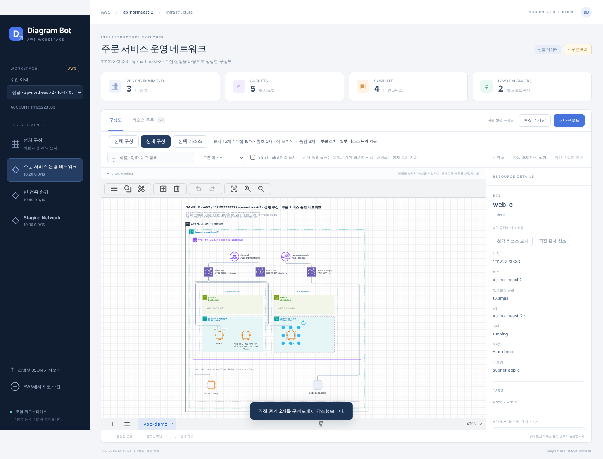

# Diagram Bot — AWS 구성도 워크스페이스

AWS 설정을 읽어 **편집 가능한 draw.io 구성도**를 자동 생성하는 로컬 웹 앱입니다. VPC 환경을 탐색하고, 리소스의 속성과 API 관계 근거를 확인하고, 편집본을 **`.drawio`·PNG**로 다운로드할 수 있습니다. AWS 인증 없이 바로 시연할 수 있는 샘플이 포함되어 있습니다.



## 바로 실행

Python 3.11 이상, 데스크톱 Chrome/Chromium을 권장합니다.

```bash
git clone https://github.com/men16922/diagram-bot.git
cd diagram-bot
python -m venv .venv
source .venv/bin/activate
pip install -e .
diagram-bot setup-editor
diagram-bot serve
```

**http://127.0.0.1:8765**를 엽니다. 처음부터 합성 AWS 샘플이 표시됩니다. Windows에서는 가상환경 활성화 명령을 `.venv\Scripts\activate`로 바꿉니다.

`setup-editor`는 최초 한 번 공식 draw.io **32.4.1** 배포물(약 48 MB)을 다운로드하고 고정 SHA-256을 확인합니다. 이후 구성도 편집과 PNG 생성은 로컬에서 수행합니다. 오프라인 설치에는 동일 버전의 공식 `draw.war`를 준비해 `diagram-bot setup-editor --archive /path/to/draw.war`를 사용합니다. [배포물 출처와 라이선스](THIRD_PARTY_NOTICES.md)를 참고하세요.

[5분 시연 순서](docs/DEMO.md) · [AWS best practice 샘플 5종](examples/samples/README.md) · [개발 계획과 구현 범위](docs/PLAN.md) · [GitHub 개발 안내](GITHUB.md)

## 시연 버전에서 할 수 있는 것

- **세 가지 보기:** 계정·리전·VPC 요약 카드의 `전체 구성`, 한 VPC의 AZ·서브넷·EC2·ALB·대상 그룹을 그린 `상세 구성`, 선택 리소스와 직접 관계·필요한 상위 경계만 그린 `선택 리소스`. 각 보기는 표시/수집/참조/숨김 수와 부분 조회 여부를 함께 보여줍니다.
- **인프라 아키텍처 표기:** AWS Cloud > Region > VPC > AZ > 서브넷(라우팅으로 퍼블릭·프라이빗·격리 구분)에 Internet/NAT Gateway, RDS 기본·대기, AZ를 가로지르는 Auto Scaling 그룹 프레임을 AWS Architecture Icons 스타일로 그립니다.
- **결정적 자동 배치:** 로드밸런서 → 대상 그룹 → AZ 열·서브넷 순서의 계층 배치. 연결선은 채널과 AZ 사이 통로로만 지나가 다른 도형을 가로지르지 않습니다. 같은 입력은 항상 같은 좌표를 만듭니다([배치 엔진 평가](docs/engineering/LAYOUT_EVALUATION.md)).
- 선택한 리소스의 속성·태그·관계와 API 근거, 포트·AZ 한정자, 구성도에서 직접 관계 강조.
- 실제 draw.io 도형 이동·스타일 수정·메모 편집. 편집본은 보기별로 저장되며, 덮어쓴 버전은 이력에 보관됩니다.
- `자동 배치 다시 실행`은 이전 편집본을 보관하고 메모를 유지합니다. `이전 편집본 복원` 지원.
- 이름·ID·태그·IP 검색, 리소스 종류별 목록, SG·ENI·EBS 참조 표시 전환.
- 현재 보기의 `.drawio`·PNG 다운로드. PNG는 1×/2×/3×와 흰색/투명 배경 지원.
- 전체 스냅샷 JSON·리소스 CSV 다운로드, JSON 가져오기, 수집 이력 선택.
- 기존 SDK/SSO 인증으로 읽기 전용 수집 시작, 완료·부분 조회·조회 불가와 필요한 IAM 권한 표시.

검색과 종류 선택은 리소스 목록 및 검색 결과를 필터링합니다. 구성도 범위는 보기 선택과 참조 표시로 정합니다. 수동 편집은 구성도 표현에만 적용되며 원본 AWS 수집 데이터는 바뀌지 않습니다.

## 실제 AWS 연결

```bash
aws sso login --profile my-sso-profile
diagram-bot serve
```

화면의 **AWS에서 새로 수집**에서 프로파일, 예상 계정 ID, 리전을 지정합니다. 프로파일을 지정하지 않으면 boto3의 기본 인증 체인을 사용합니다. 기존 `AWS_CONFIG_FILE`·`AWS_PROFILE`·`credential_process`도 SDK가 처리합니다. STS의 실제 계정 ID와 예상 계정 ID가 다르면 리소스를 수집하지 않습니다. 브라우저에서 SSO 로그인을 대신 수행하지는 않습니다.

수집기는 `sts:GetCallerIdentity`와 [읽기 전용 정책 예시](readonly-policy.json)의 Describe API(EC2·ELBv2·RDS·Auto Scaling)만 호출합니다. 일부 권한이 없으면 해당 범위만 `조회 불가`로 표시하고 나머지는 그립니다. 정책을 자동 적용하지 않으며 키나 토큰을 앱·산출물에 저장하지 않습니다.

| 범위 | API 근거 |
| --- | --- |
| VPC·서브넷·가용 영역 | DescribeVpcs, DescribeSubnets |
| EC2와 VPC·서브넷 | DescribeInstances.VpcId/SubnetId |
| EC2의 보안 그룹·ENI·EBS 참조 | DescribeInstances의 리소스 ID |
| ELBv2의 VPC·여러 서브넷·보안 그룹 | DescribeLoadBalancers |
| 대상 그룹과 로드밸런서 | DescribeTargetGroups.LoadBalancerArns |
| 등록 대상과 상태 | DescribeTargetHealth |
| 인터넷 경로·NAT | DescribeInternetGateways.Attachments, DescribeNatGateways.SubnetId |
| 서브넷 유형(퍼블릭/프라이빗/격리) | DescribeRouteTables의 연결·`0.0.0.0/0` 경로 (명시 연결 없으면 기본 테이블) |
| RDS와 Multi-AZ 대기 | DescribeDBInstances의 AZ·SecondaryAvailabilityZone·DBSubnetGroup |
| Auto Scaling 그룹 | DescribeAutoScalingGroups의 Instances·TargetGroupARNs |

ALB는 여러 서브넷에 걸쳐도 VPC 수준에 한 번만 그리며, 서브넷 연결은 속성 패널과 선택 리소스 보기에서 확인합니다. 대상 그룹은 논리 자원으로 서브넷 밖에 둡니다. 관계 ID는 출발·대상·관계 종류와 포트·AZ로 정해지므로 조회 순서나 상태가 바뀌어도 유지됩니다. SG·ENI·EBS는 **참조만** 표시하며 상세 조회하지 않습니다. IP·Lambda 대상은 별도 등록 대상으로 남기고 EC2와 추측으로 합치지 않습니다. 그래프 관계에는 API 근거와 `inferred: false`가 기록됩니다. 보안 그룹 허용 규칙과 실제 통신을 혼동하지 않습니다.

SDK 페이지네이션·재시도·타임아웃을 적용합니다. `partial`은 일부 페이지 실패, `unavailable`은 한 페이지도 조회하지 못한 상태이며 리소스가 없다는 뜻이 아닙니다. 앞서 조회한 데이터는 보존합니다. 수집 시작·종료 시각과 범위를 기록하며 순차 API 조회이므로 원자적 스냅샷은 아닙니다.

## 로컬 데이터와 CLI 보고서

편집기는 기본적으로 `~/.cache/diagram-bot/drawio/32.4.1`, 스냅샷과 편집본은 `~/.local/share/diagram-bot`에 저장합니다. `XDG_CACHE_HOME`·`XDG_DATA_HOME` 또는 `serve --data-dir reports/workspace`로 위치를 바꿀 수 있습니다. 서버는 `127.0.0.1`에만 바인딩합니다.

기존 단독 HTML 보고서도 생성할 수 있습니다.

```bash
diagram-bot demo --output reports/demo
diagram-bot demo --sample three-tier --output reports/three-tier   # three-tier | microservices | nlb-alb | environments | hybrid
diagram-bot collect --profile my-sso-profile --region ap-northeast-2 \
  --expected-account 123456789012 --output reports/current
diagram-bot render reports/current/snapshot.json --output reports/rerendered
```

| CLI 산출물 | 내용 |
| --- | --- |
| `topology.drawio` | 자동 생성된 편집 가능한 구성도 (전체 구성 + VPC별 상세 페이지) |
| `index.html` | 서버 없이 여는 조회용 HTML·속성·필터·SVG 다운로드 |
| `snapshot.json` | 원본 응답·그래프·API별 조회 상태·수집 시각 |
| `inventory.csv` | 동일 스냅샷의 리소스 내역·참조 여부·속성 |
| `review.md` | 조회 결과와 검토 항목, 자동 적합성 판정은 아님 |

**PNG 다운로드는 `serve` 웹 앱에서 제공합니다.** CLI의 HTML 뷰어와 draw.io 편집기는 별도 화면입니다. 부분 수집이어도 보고서를 생성하며 `collect` 종료 코드는 정상 0, 부분 조회 2, 인증·계정 불일치·파일 오류 1입니다. 실제 수집 데이터는 `reports/` 등 Git 추적 제외 경로에 보관하세요.

## 검증과 현재 한계

```bash
pip install -e '.[test,browser]' build
pytest -q
python -m build
python -m playwright install chromium
# 별도 터미널에서 새 데이터 디렉터리로 앱을 실행한 뒤:
# diagram-bot serve --data-dir reports/browser-check
python scripts/verify_demo.py
```

자동 테스트 **42개**와 Chromium 시연 검증을 통과했습니다. 테스트는 관계 ID 안정성, 보기별 범위, 도형 겹침·컨테이너 밖 잘림·도형을 가로지르는 연결선이 없는지, 100개 리소스 배치 시간(약 0.02초, 합성 데이터)을 확인합니다. 브라우저 검증은 보기 전환, 관계 근거·강조, 키보드 이동과 메모 편집, 저장/재열기, 편집본이 반영된 `.drawio`·PNG(1×/2×/3×)·JSON·CSV, 자동 재배치·복원, JSON 가져오기를 확인합니다. 화면·PNG·검증 JSON은 `artifacts/browser/`에 생성됩니다. CI에서도 Python 3.11/3.12/3.13 패키지 테스트와 Chromium 검증을 실행합니다.

현재는 **단일 사용자 로컬 시연 버전**입니다. 다중 사용자 인증·동시 편집, 수집 작업의 재시작 복구, 예약 수집, 변경 비교, RDS·EKS·라우팅·실제 트래픽 분석, 대규모 계정 성능 검증은 포함하지 않습니다. 이 환경에는 AWS 인증이 없어 실제 계정의 권한·접속·SSO 갱신은 검증하지 못했으며, 수집 로직은 모의 AWS 응답으로 검증했습니다.
