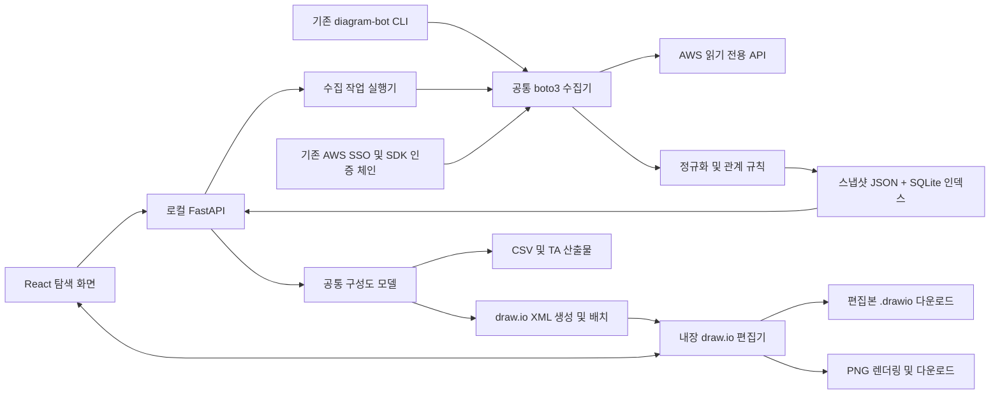

# Diagram Bot — AWS 구성도 탐색 도구 개발 계획

> 보관 문서 (2026-10-19, 원래 위치 `docs/PLAN.md`): 2026-10-17의 최초 제품 계획과 구현 이력이다. 현재 상태는 [STATUS.md](../STATUS.md), 열린 작업은 [NEXT_PLAN.md](../NEXT_PLAN.md).
>
> 당시 작업 계획: [AWS 자동 구성도 개선 계획](TOPOLOGY_PLAN.md). 2026-10-17 사용자 요청에 따라
> SSO 직접 조회·관계 기반 자동 배치·전체/상세/선택 보기·draw.io/PNG 시연으로 범위를 확정했다.
> 아래 문서는 기존 구현 이력과 장기 제품안이며, 충돌 시 새 계획의 범위와 기술 선택을 따른다.

- 작성일: 2026-10-17
- 상태: v0.2 시연 버전 구현·검증 완료. 아래 구현 현황 이외의 항목은 후속 계획.
- 기준 코드: `af4272e` — Python 수집기 + 단독 HTML 보고서
- 대상: AWS. 첫 제품 버전은 한 계정·한 리전, 이후 여러 AWS 계정·리전으로 확장.
- 사용자 지정: 구성도 생성·편집은 **draw.io**, 첫 버전 필수 다운로드는 **`.drawio`와 `.png`**.

## 시연 버전 구현 현황 (2026-10-17)

사용자 요청에 따라 완료 기준을 시연 수준으로 확정했다. 원래의 제품 확장 계획은 아래에 유지하되, 실제 구현 범위는 다음과 같다.

| 영역 | 구현 상태 |
| --- | --- |
| 수집·API | 기존 boto3 수집기 + FastAPI, 프로파일·예상 계정·리전 선택, 부분 조회 표시 |
| 화면 | AWS 워크스페이스, VPC 전환, 속성·관계 근거, 검색·목록·참조 표시 |
| 편집기 | 공식 draw.io 32.4.1 로컬 설치, 네이티브 XML·AWS 아이콘·그룹·메모·배치 편집 |
| 산출물 | 최신 편집본 `.drawio`·PNG, 1×/2×/3× 및 투명 배경, JSON·CSV, 기존 CLI 보고서 |
| 저장 | 로컬 JSON 파일, 스냅샷별·보기별 편집본, revision 충돌 방지 |
| 검증 | pytest 24개 및 Chromium 편집·저장·다운로드 시연; 실제 AWS 인증 검증 제외 |

시연 구현은 **FastAPI + 빌드 과정 없는 JavaScript/CSS + 로컬 JSON 저장**을 사용한다. 아래의 React/TypeScript·SQLite·다중 페이지 출력·완전한 편집 모델 보호·스냅샷 차이·대규모 성능 기준은 후속 계획이며 현재 완료 항목이 아니다. 구성도 도형과 연결선은 사용자가 표현을 수정할 수 있고, 수집 데이터·API 근거는 별도로 보존한다. AWS 관계선의 끝점을 다른 리소스로 재연결하는 동작은 제한한다.

실행 및 재현은 [README](../../README.md)와 [시연 가이드](../DEMO.md)를 따른다. 이후 본문의 “현재 구현”은 계획 작성 시점의 기준 코드 상태를 뜻한다.

## 1. 목표와 제품 방향

**SSO로 접근 가능한 AWS 환경을 수집하고, 자동 배치된 구성도에서 리소스·관계·속성을 탐색해 TA 검토 자료까지 출력한다.**

Hava의 공개 기능 중 자동 배치, 리소스 선택과 속성 패널 연동, 구성도/목록 보기 전환, 이력 비교를 참고한다. 공개 기능을 제품 요구사항으로 정리하고 AWS SDK와 자체 데이터 모델로 구현한다. 참고 자료는 문서 끝에 명시한다.

사용자가 수행할 핵심 흐름:

1. 기존 AWS 프로파일, 예상 계정 ID, 리전을 선택한다.
2. 읽기 전용 수집을 실행하고 완료·부분 조회·실패 범위를 확인한다.
3. VPC 환경을 열어 자동 생성된 draw.io 구성도를 AWS 아이콘으로 탐색하고 위치·스타일·주석을 편집한다.
4. 리소스를 선택해 주요 속성, 태그, 연결 관계, API 근거를 확인한다.
5. 편집한 구성도를 `.drawio` 파일 또는 PNG로 다운로드하고, 같은 스냅샷의 리소스 목록·검토 자료도 출력한다.
6. 후속 버전에서 수집 이력을 선택하고 이전 구성과 비교한다.

첫 실행 모델은 **사용자 PC에서 실행하는 로컬 웹 앱**으로 정한다. 기존 SSO 자격증명을 재사용하기 쉽고, 수집한 구성 데이터도 로컬에 보관할 수 있다. 사내 서버 공동 사용은 후속 배포 단계로 분리한다.

## 2. 현재 구현과 필요한 변화

| 영역 | 현재 구현 | 목표 |
| --- | --- | --- |
| 인증·수집 | CLI에서 프로파일·계정·리전 지정 | 화면에서 프로파일 선택, 인증 상태 확인, 수집 작업 실행 |
| 구성도 | HTML 카드 배치와 SVG 연결선 | 내장 draw.io 편집기, AWS 아이콘, 계층형 자동 배치, 팬·줌, 개요, 그룹 접기 |
| 탐색 | 이름/ID 검색, 종류·관계 필터 | VPC 환경 탐색, 태그/IP 검색, 연결 리소스 강조, 저장된 보기 |
| 속성 | 원본 JSON 중심 | 요약·태그·관계·조회 근거 탭, 원본 응답은 펼쳐보기 |
| 수집 범위 | VPC, Subnet, EC2, ELBv2, TargetGroup, 등록 대상 | 1차 범위 유지 후 네트워크·SG·RDS를 단계적으로 추가 |
| 보조 리소스 | SG·ENI·EBS 참조만 확인 | 별도 상세 조회 후 상세 패널과 목록에 제공 |
| 기록 | 실행별 파일, 비교 기능 없음 | 변경 불가능한 스냅샷, 이력 목록, 설정 차이 비교 |
| 산출물 | HTML, JSON, CSV, 검토 Markdown, 화면 SVG | 편집 가능한 `.drawio`, PNG 다운로드 필수. SVG와 기존 데이터 산출물 유지 |

현재 수집기, 그래프 생성 규칙, 11개 테스트는 출발점으로 재사용한다. 현재 구현을 새 UI에 연결할 때 API에서 확인된 관계와 부분 조회 표시를 유지한다.

## 3. 화면 계획

### 기본 시각 스타일

- 밝은 캔버스와 옅은 격자, 경계가 명확한 VPC·AZ·서브넷 그룹을 사용한다.
- AWS 공식 아이콘과 짧은 이름을 중심으로 표시하고, 긴 ARN·상세 속성은 오른쪽 패널에 배치한다.
- 리소스 종류는 아이콘으로 구분하고, 색상은 선택·조회 상태·변경 상태에 사용한다. 상태는 텍스트와 기호도 함께 표시한다.
- 화면은 데스크톱 1440×900을 우선 설계한다. 작은 화면에서는 탐색기와 속성 패널을 접는다.
- draw.io 편집기 정적 자산과 AWS 도형을 버전 고정해 로컬 배포물에 포함한다. 설치 후 편집·PNG 생성은 로컬에서 수행하며 아이콘 출처와 사용 조건을 기록한다.

```text
┌ Diagram Bot ─ AWS 프로파일 / 계정 / 리전 ─ 수집 시각·상태 ─ 새로 수집 ┐
├ 환경 탐색기 ─────┬ 구성도 | 리소스 목록 ─ 검색·필터·보기·내보내기 ────┤
│ 계정 / 리전     │                                  │ 속성 패널    │
│  VPC 환경 목록  │   VPC                            │ 요약         │
│  저장된 보기    │    AZ-a          AZ-c             │ 태그         │
│                │    Subnet        Subnet           │ 관계         │
│                │    EC2           EC2              │ API 근거     │
│                │    VPC 수준: ALB · TargetGroup     │ 조회 상태    │
│                │                                  │              │
│                │ 팬·줌 / 전체 맞춤 / 미니맵        │              │
├────────────────┴──────────────────────────────────┴──────────────┤
│ 수집 작업: 완료 API / 부분 조회 / 조회 불가 / 범위 밖               │
└──────────────────────────────────────────────────────────────────┘
```

### 주요 상호작용

| 기능 | 동작 |
| --- | --- |
| 환경 선택 | VPC별 구성도를 기본 단위로 열고, VPC 외 리소스는 별도 환경에서 표시 |
| 리소스 선택 | 구성도와 목록의 선택을 동기화하고 오른쪽 속성 패널 갱신 |
| 관계 탐색 | 선택 리소스의 직접 연결만 강조. 나머지 연결은 흐리게 표시 |
| 연결선 표시 | 포함·등록·연결·라우팅·SG 규칙을 종류별로 켜고 끄며 의미와 근거 표시 |
| 검색 | 이름, ID/ARN, IP, 태그로 찾고 해당 노드로 이동 |
| 그룹 접기 | VPC/AZ/서브넷을 요약하고 숨긴 리소스 개수 표시 |
| 자동 배치 | 데이터 변경 시 재배치. 동일 스냅샷과 옵션이면 안정적인 배치 제공 |
| draw.io 편집 | 위치·스타일·라벨·주석을 편집하고 편집본 XML 저장. AWS 원본 설정은 보존 |
| 저장된 보기 | 환경 범위, 종류·태그 필터, 연결선 옵션, 접힌 그룹, 위치 설정 저장 |
| `.drawio` 다운로드 | 현재 편집본을 draw.io에서 다시 열 수 있는 XML 문서로 다운로드 |
| PNG 다운로드 | 같은 편집본을 이미지로 렌더링. 현재 보기 / 전체 환경, 해상도·배경을 선택 |

ALB처럼 여러 서브넷에 속하는 리소스는 VPC 수준에 하나만 표시하고 배치 관계를 연결한다. SG·ENI·EBS는 기본 구성도의 노드 수를 늘리지 않도록 상세 패널·목록 중심으로 제공하며 필요할 때 확장한다. 그룹 박스와 리소스 아이콘의 중복 표시는 줄인다.

후속 화면은 네트워크 보기, 보안 그룹 보기, 스냅샷 이력/변경 비교다. 미구현 화면의 활성 버튼은 먼저 노출하지 않는다.

### draw.io 문서와 PNG 다운로드

- AWS 그래프를 `mxfile` / `mxGraphModel` 문서로 생성한다. VPC/AZ/서브넷은 중첩 그룹, 리소스는 AWS 도형, 관계는 연결선으로 변환한다.
- 도형·연결선에 안정적인 리소스/관계 ID를 매핑해 속성 패널과 연동한다. 수동 주석은 AWS 리소스와 구분한다.
- 자동 생성 구성과 사용자 주석/편집 정보를 분리한다. 수동으로 추가한 선은 사용자 주석이며 API가 확인한 관계나 인벤토리에 포함하지 않는다.
- 편집본은 기준 snapshot ID와 revision을 가진다. 재수집은 새 기준 문서를 만들고 기존 편집본을 보존한다. 위치·스타일은 일치하는 ID에만 재적용하며 옮길 수 없는 편집은 표시한다.
- 다운로드 버튼은 `draw.io 파일`과 `PNG 이미지`로 제공한다. 저장하지 않은 최신 편집까지 반영한 동일 revision에서 두 형식을 생성한다.
- PNG 기본값은 흰 배경·2배 해상도·격자 숨김이다. 1배/2배/3배와 투명 배경을 선택할 수 있다. 기본 PNG는 이미지 전용이며 편집 데이터 포함 옵션은 별도로 둔다.
- 현재 보기는 필터와 접힌 그룹을 반영한 문서 전체 영역을 뜻한다. 화면 일부를 캡처하지 않고 도형 경계와 여백을 기준으로 출력한다.
- 여러 VPC/페이지를 전체 내보내기하면 `.drawio`는 다중 페이지 문서, PNG는 페이지별 이미지 ZIP으로 제공한다. 단일 페이지는 PNG 한 파일로 다운로드한다.
- 이미지에도 계정·리전·수집 시각·부분 조회 여부와 편집본 표시를 넣는다. 렌더링 한도를 넘으면 해상도 축소 또는 페이지별 출력을 안내한다.

## 4. AWS 지원 범위

| 단계 | 리소스 | 조회 근거·핵심 관계 |
| --- | --- | --- |
| 첫 버전 | VPC, Subnet, EC2 | 기존 DescribeVpcs/Subnets/Instances; VPC·서브넷·AZ·참조 관계 |
| 첫 버전 | ALB/NLB 등 ELBv2, TargetGroup, 등록 대상 | 기존 DescribeLoadBalancers/TargetGroups/TargetHealth; 배치·등록·연결 |
| 확장 1 | Security Group, ENI, EBS | DescribeSecurityGroups/NetworkInterfaces/Volumes; 규칙·연결·장착 상세 |
| 확장 1 | Route Table, IGW, NAT Gateway, VPC Endpoint | 해당 EC2 Describe API; 서브넷 연결, 라우트 대상, 게이트웨이 연결 |
| 확장 1 | ELBv2 Listener / Rule | DescribeListeners/Rules; forward 대상, redirect/fixed-response 동작 구분 |
| 확장 1 | RDS DB Instance / Cluster / Subnet Group | DescribeDBInstances/DBClusters/DBSubnetGroups; 멤버십, VPC/배치 후보, SG |
| 후속 후보 | ECS, EKS, Lambda, S3, DynamoDB, CloudFront, Route 53, TGW, Peering | 실제 TA 사용 빈도에 따라 API와 관계 규칙을 개별 설계 |

첫 버전에 Classic ELB, AWS 외 클라우드, 비용 추정, 리소스 생성/수정, 실시간 트래픽 분석, LLM 관계 추론, 팀 공동 편집은 포함하지 않는다. EKS 내부 워크로드는 AWS EKS API만으로 충분하지 않으므로 Kubernetes API 접근을 별도 과제로 다룬다.

### 관계 정확성 규칙

- `설정상 연결`, `배치`, `허용 규칙`, `관측 상태`를 구분한다. 모두를 일반적인 통신 화살표로 표시하지 않는다.
- SG 참조와 포트 허용은 규칙이다. 해당 리소스 간 실제 통신이나 종단 간 도달 가능성을 의미하지 않는다.
- 서브넷 이름으로 Public/Private을 결정하지 않는다. 명시적 라우트 테이블 연결과 main 테이블 상속을 해석하고 근거를 표시한다. 경로 정보가 불완전하면 미확인으로 남긴다.
- IGW/NAT/Endpoint로 향하는 라우트는 구성된 경로다. 인터넷 접근 가능성은 IP·SG·NACL 등 추가 조건이 필요하므로 단정하지 않는다.
- RDS DBSubnetGroup의 서브넷 목록은 배치 가능 범위이며 실제 노드가 모든 서브넷에 존재한다는 뜻이 아니다. API가 확인한 실제 위치와 배치 후보를 별도 관계로 표현한다.
- IP 대상은 동일 IP를 가진 EC2에 임의로 합치지 않는다. 리소스를 수집하지 못했더라도 명시적인 참조는 남긴다.
- Lambda·S3 등 VPC 외 리소스를 향후 추가할 때 VPC/서브넷 소속을 강제하지 않는다.

## 5. 기술 구조

기본안은 **React + TypeScript 앱 화면 + 내장 draw.io 편집기 / Python FastAPI + boto3 / SQLite + JSON 스냅샷·draw.io XML**이다. draw.io가 구성도 표시·편집·이미지 출력을 담당한다. 라이브러리와 편집기 버전은 구현 시 호환성을 검증하고 고정한다.



| 구성 요소 | 설계 |
| --- | --- |
| 프런트엔드 | React/TypeScript/Vite. 화면 상태와 AWS 원본 데이터 분리 |
| 캔버스 | 고정 버전의 draw.io 편집기를 iframe에 내장. React는 환경 탐색기·속성 패널·수집 화면 담당 |
| 편집기 연동 | JSON 메시지 어댑터로 로드·저장·내보내기 처리. origin/source 검증과 응답 시간 제한 적용 |
| 선택 연동 | 선택 cell ID와 리소스 ID 연결. 편집기 버전의 이벤트 지원 확인 후 필요한 최소 어댑터 작성 |
| 배치 작업 | VPC/AZ/서브넷 컨테이너와 geometry를 결정적으로 생성. draw.io 배치 기능의 보완 적용을 M0에서 검증 |
| 이미지 출력 | draw.io의 PNG 내보내기 경로 사용. 아이콘·폰트를 로컬에서 해석하며 외부 변환 서버 없이 동작 검증 |
| API | FastAPI가 정적 UI와 같은 origin에서 제공. 브라우저는 AWS API를 직접 호출하지 않음 |
| 인증 | 서버가 기존 boto3 프로파일·기본 인증 체인 사용. 토큰/키는 브라우저 응답·DB·스냅샷에 넣지 않음 |
| 로컬 접근 | 기본 127.0.0.1 바인딩. 허용 origin/host와 앱 세션 검증으로 수집 실행 API 보호 |
| 작업 실행 | 1개 앱 프로세스와 제한된 수집 worker로 시작. 작업 상태를 DB에 기록하고 재시작 시 중단 상태 복구 |
| 저장 | SQLite는 source/job/snapshot/view/document 인덱스, JSON은 수집 결과, XML은 기준·편집 문서. 원자적 저장 |
| 배포 | UI와 draw.io 정적 배포물을 고정 버전·체크섬으로 패키징. 출처·라이선스 고지 포함. `diagram-bot serve` 추가, 기존 CLI 유지 |

M0에서 draw.io XML 왕복 저장, 그룹 경계, 연결선, AWS 도형, 선택 이벤트, PNG 생성을 검증한다. 공식 호스팅 embed API를 로컬 배포가 동일하게 지원한다고 가정하지 않고 선택한 오픈소스 편집기 버전의 동작을 확인한다. 필요한 연동은 작은 어댑터로 격리한다. 자동 배치는 그룹별 좌표 계산을 기본으로 검증하며 보조 알고리즘은 이 단계에서 결정한다.

초기 저장 위치는 Git 작업 트리 밖의 사용자 앱 데이터 디렉터리로 한다. 스냅샷 삭제/보관 정책을 명시하고 오래된 이력을 자동으로 무제한 축적하지 않도록 후속 운영 설정을 둔다.

### API 초안

- `GET /api/sources`: 등록된 프로파일·예상 계정·리전과 인증 확인 상태.
- `POST /api/sources/{id}/validate`: STS로 계정 검증. SSO 만료 시 재로그인 필요 상태 반환.
- `POST /api/collections`: 선택한 source와 범위의 수집 작업 생성.
- `GET /api/collections/{id}`: 진행 상태, API별 성공·실패, 스냅샷 ID.
- `GET /api/snapshots` / `GET /api/snapshots/{id}`: 수집 이력과 결과.
- `GET /api/snapshots/{id}/graph` / `.../resources`: 같은 스냅샷의 구성도·내역.
- `GET/POST /api/views`: 저장된 필터·레이아웃.
- `GET /api/views/{id}/document` / `PUT .../document`: 기준 스냅샷에 연결된 draw.io XML 편집본. revision으로 덮어쓰기 충돌 검출.
- `GET /api/views/{id}/exports/drawio`: 저장된 편집본 다운로드. 화면의 최신 편집과 PNG 출력은 편집기 어댑터에서 같은 revision으로 처리.
- 후속 `GET /api/diffs?before=...&after=...`: 비교 범위와 설정 변경 결과.

SSO 로그인 자체는 첫 버전에서 사용자가 기존 AWS CLI로 수행한다. 화면은 만료 상태와 필요한 로그인 명령을 안내한다. 전체 SSO 계정 자동 열거와 브라우저 로그인 흐름은 첫 버전의 필수 기능으로 두지 않는다.

## 6. 데이터 계약과 이력

현재 `schema_version: 1`은 읽기 어댑터로 지원하고, 신규 필드가 필요한 시점에 v2를 도입한다. 기존 보고서는 그대로 열 수 있게 한다.

| 객체 | 필수 내용 |
| --- | --- |
| Source | 식별자, 프로파일 이름, 예상 계정, partition, 대상 리전; 자격증명 값 제외 |
| CollectionJob | 요청 범위, queued/running/completed/partial/failed/interrupted, API별 진행·오류 |
| Snapshot | ID, schema/collector/rule 버전, 계정·리전·서비스 범위, 시작·종료 시각, coverage |
| Resource | 안정적 ID, ARN/서비스 ID, 종류, 계정·partition·리전, 속성, 직접 조회/참조만 확인 상태 |
| Relation | 안정적 ID, 양 끝 리소스, 관계 종류, API/필드/규칙 근거, 관련 포트·프로토콜 등의 한정자 |
| View | snapshot 또는 환경 범위, 필터, 펼침 상태, 배치 옵션·버전, 사용자 위치 조정 |
| DiagramDocument | snapshot ID, view ID, 기준/편집 구분, revision, draw.io XML, cell→resource/relation 매핑, 편집기 버전 |
| Export | snapshot ID, document revision, 범위·필터·페이지, 형식, 해상도·배경, 수집 시각, 생성 시각, coverage 요약 |

리소스 키는 partition/account/region/service/type/id로 구분하고, ARN이 있어도 계정·리전 범위를 검증한다. 동일 등록 대상의 포트별 관계를 구분한다. 원본 설정 데이터와 화면 노드 위치를 분리하며, 화면에 한 리소스를 여러 곳에서 참조해도 인벤토리는 중복 집계하지 않는다.

Coverage는 계정/리전/API/요청 범위별로 남긴다. `complete`, `partial`, `unavailable`, `not_discovered`를 유지하고 지원하지 않는 서비스는 `out_of_scope`로 구분한다. 필터에 가려진 리소스는 수집 누락과 다른 상태다.

이력 비교는 동일 환경·서비스 범위와 호환 가능한 정규화 버전끼리 수행한다. 두 수집 결과에서 해당 열거 API 범위가 완전한 경우에만 부재를 삭제 후보로 판정한다. 실패·범위 축소·지원 서비스 변경으로 보이지 않는 항목은 `확인 불가`로 표시한다. 태그·SG·라우팅 등의 설정 변경과 TargetHealth 등 일시 상태 변경은 별도로 다룬다. 수집 도중 변경될 수 있으므로 삭제 표시는 AWS 삭제 이벤트 확정이 아닌 스냅샷 간 부재임을 명시한다.

## 7. 단계별 실행 계획

**첫 제품 버전의 완료 범위는 M0~M2다.** 기존 서비스 범위로 새로운 탐색 경험과 실제 수집 연결을 먼저 완성한다.

| 단계 | 작업 | 완료 기준 |
| --- | --- | --- |
| M0 — draw.io 기반 | v1 어댑터, XML 생성·왕복 저장, AWS 도형, 중첩 그룹 배치, 선택 이벤트, PNG 경로 검증 | 2 VPC·3 AZ·다중 서브넷 ALB·미조회 참조가 올바르게 표시. 로컬 편집기에서 로드·저장·PNG 생성 성공 |
| M1 — 구성도 UI·다운로드 | 앱 틀, draw.io 내장, 환경 탐색기·속성·검색·필터·목록 연동, 편집본 저장, `.drawio`와 PNG 다운로드 | 저장하지 않은 편집까지 두 산출물에 일치. `.drawio` 재열기와 PNG의 전체 범위·한글·아이콘·해상도 검증 |
| M2 — 실제 AWS 연결 | FastAPI, 프로파일 등록/검증, 수집 작업, 진행/오류 상태, 로컬 저장, 패키징 | 한 계정·한 리전을 실제 SSO로 수집해 UI에 표시. 실패해도 마지막 스냅샷과 부분 조회 범위를 확인 가능 |
| M3 — 네트워크·DB | SG/ENI/EBS 상세, 라우팅·게이트웨이·Endpoint, Listener/Rule, RDS, 네트워크/SG 보기 | 직접 관계와 규칙을 구분하고 신규 API 권한/부분 실패 테스트 및 실제 환경 검증 통과 |
| M4 — 이력·비교 | 이력 선택, 설정 diff, 추가/변경/부재/확인 불가 표시, 비교 자료 출력 | 권한 부족·수집 범위 차이로 삭제를 잘못 표시하지 않음. 이전 스냅샷도 탐색 가능 |
| M5 — AWS 확장·운영 | 여러 계정/리전, 제한된 동시 수집, 예약 수집, TA 우선 서비스 추가 | 범위별 실패 격리, 계정 간 ID 충돌 방지, 인증 만료·재실행·보관 정책 검증 |

예약 수집은 실행 환경에 유효한 인증이 있어야 한다. SSO 재로그인이 필요한 경우 중단 상태를 노출한다. 상시 서버 수집이 필요해지면 별도의 역할 기반 인증·배포 설계를 추가한다.

작업 의존성은 `M0 → M1 → M2 → M3 → M4 → M5`다. M1은 실제 AWS 인증 없이 진행 가능하다. 일정은 M0의 레이아웃 실험과 M2의 실제 AWS 접근 검증 결과에 따라 산정한다.

### 첫 구현 PR의 구체적 범위

M0와 M1의 첫 화면을 다음 개발 단위로 삼는다.

- `web/`에 TypeScript 앱과 프런트엔드 잠금 파일 추가.
- v1 스냅샷을 읽는 타입/어댑터와 합성 fixture 추가.
- 공통 그래프를 draw.io XML로 변환하고 cell ID에 리소스·관계 ID 연결.
- 로컬 draw.io 편집기 내장, VPC/AZ/서브넷 그룹·AWS 도형·선택 속성 패널 구현.
- 팬·줌·전체 맞춤·연결 강조와 배치 실험, 사용자 편집본 저장 구현.
- `.drawio` 다운로드와 PNG 다운로드를 첫 PR의 필수 기능으로 구현.
- 기존 CLI 수집/보고서 테스트와 Python 패키지 동작 유지.
- UI 빌드/타입 검사와 핵심 브라우저 시나리오를 CI에 추가.

이 PR의 완료 시점에는 실제 AWS 연결 없이도 합성 샘플을 편집하고 `.drawio`와 PNG를 내려받아 결과를 검토할 수 있어야 한다.

## 8. 검증과 출시 기준

| 검증 영역 | 확인할 시나리오 |
| --- | --- |
| 수집 | EC2/ELB 페이지네이션, 중간 실패 보존, 인증 만료, 계정 불일치, 재시도, 서비스별 권한 부족 |
| 관계 | 다중 서브넷 ALB, 다중 포트 대상, 미조회 리소스 참조, SG 규칙, main 라우트 테이블 상속, RDS 배치 후보 |
| UI | 선택/목록 동기화, 검색 후 이동, 필터 상태 보존, 그룹 접기, 범례, 키보드 탐색, 긴 이름/ARN |
| 문서 왕복 | `.drawio`를 다시 열어 리소스 ID·그룹·연결·위치·주석 유지. 편집본이 원본 인벤토리를 변경하지 않음 |
| 출력 | `.drawio`·PNG의 동일 revision, 화면·CSV·JSON의 snapshot ID 일치, 한글·AWS 도형·여백·투명 배경·1/2/3배·다중 페이지·대형 문서·수집 범위 표기 검증 |
| 편집기 통합 | init/load/save/export 흐름, 선택 이벤트, 잘못된 origin/source 무시, 타임아웃·내보내기 실패 안내 |
| 패키징 | 기존 CLI, v1 보고서, wheel 설치, 고정된 draw.io 자산·라이선스 포함, 외부 네트워크 차단 상태에서 편집·PNG 생성 |
| 이력 | 부분 조회 시 삭제 오판 방지, 범위 불일치 표시, 설정과 일시 상태 구분 |

성능 목표는 측정 전의 목표치다. M0에서 기준 장비와 fixture를 고정하고 브라우저 계측으로 확인한다.

- 한 화면 300개 표시 노드/600개 엣지: 초기 배치·표시 3초 이내, 선택 패널 응답 200ms 이내 목표.
- 1,000개 이상 리소스는 환경 분리·그룹 접기·목록 가상화를 적용하고 일괄 전개를 기본값으로 하지 않는다.
- 빈 결과, 전체 실패, 부분 조회, scope 밖, 오래된 스냅샷을 서로 구분한다.

M2 출시 조건은 실제 SSO 한 계정·한 리전에서 AWS 콘솔/API 결과와 대표 리소스 및 관계를 대조하는 것이다. 현재는 모의 테스트와 합성 샘플만 검증되어 있으며, 실제 AWS 인증 연결은 별도 선행 조건이다.

## 9. 기본 결정과 후속 결정 시점

| 항목 | 이번 계획의 기본안 | 다시 결정할 시점 |
| --- | --- | --- |
| 사용 방식 | 개인 로컬 웹 앱, 기존 SSO 재사용 | 사내 공동 접속 요구가 생길 때 |
| 초기 범위 | 한 AWS 계정·한 리전, VPC 중심 | M2 실제 사용 후 |
| 표시 언어 | 한국어 UI, AWS 서비스명/ID 원문 유지 | 다국어 요구가 생길 때 |
| 관계 생성 | SDK 응답과 명시적 규칙 | 추가 서비스마다 규칙 검토 |
| 구성도 도구 | draw.io 내장 편집기와 XML 문서 | 도구 선택은 확정, M0에서 버전·연동·배치 방식 검증 |
| 다운로드 | `.drawio`와 PNG를 첫 버전 필수로 제공 | M1에서 동일 편집본·출력 품질 검증 |
| 수집 주기 | 사용자가 요청할 때 실행 | M5 인증·운영 모델 검토 시 |
| 서비스 확장 | 네트워크/SG/RDS 우선 | 실제 TA 검토 사례 확인 후 ECS/EKS 등 선정 |

## 10. 참고 자료

2026-10-17 공개 문서를 확인했다. Hava 기능은 제품 방향 참고이며, 지원 범위와 단계는 Diagram Bot의 자체 계획이다.

- [Hava Features](https://www.hava.io/features): 자동 배치, 속성 패널, 보기 전환, 이력·비교, 출력 기능.
- [Hava 환경 필터 문서](https://docs.hava.io/using-hava/environments/filtering-environments): 환경과 보기 종류를 통한 탐색.
- [AWS Architecture Icons](https://aws.amazon.com/architecture/icons/): AWS 아이콘과 배포 자료.
- [Boto3 credentials](https://docs.aws.amazon.com/boto3/latest/guide/credentials.html): 기존 인증 체인과 IAM Identity Center 프로파일.
- [draw.io Embed mode](https://www.drawio.com/docs/reference/embed-mode/): 편집기 내장과 문서·내보내기 메시지 연동 참고.
- [draw.io PNG export](https://www.drawio.com/docs/manual/export/export-to-png/): PNG 이미지 내보내기 옵션 참고.
- [AWS VPC routing options](https://docs.aws.amazon.com/vpc/latest/userguide/route-table-options.html): 라우팅 구성과 경로 해석의 근거.
