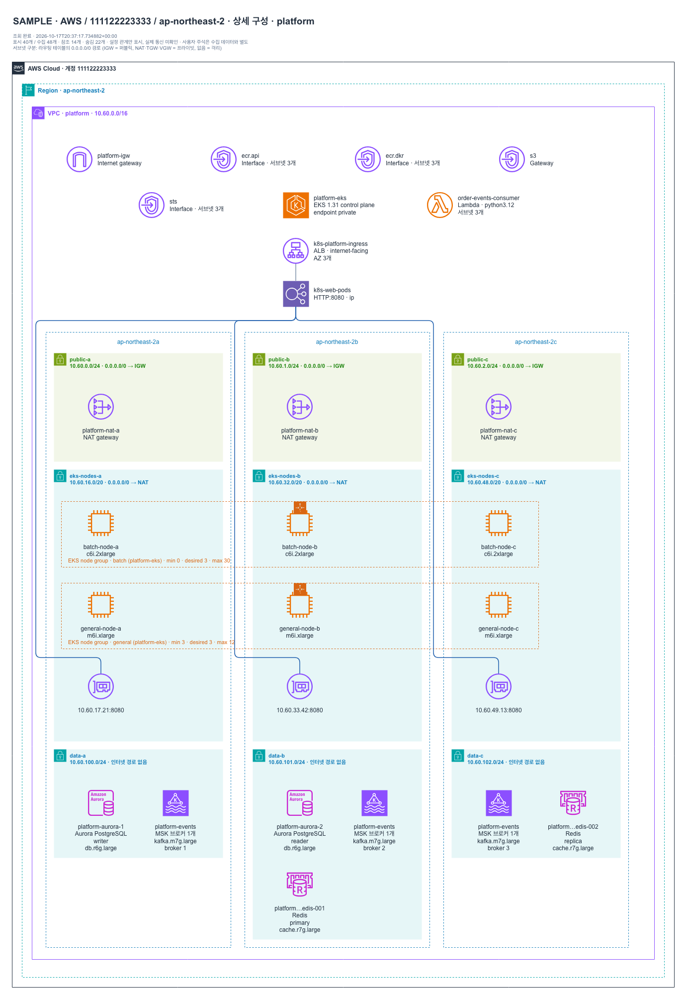
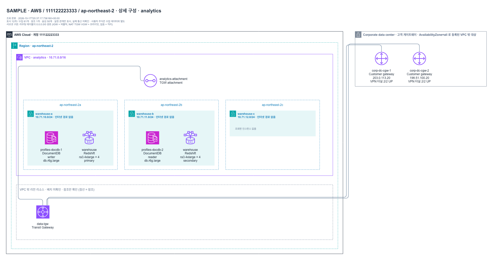
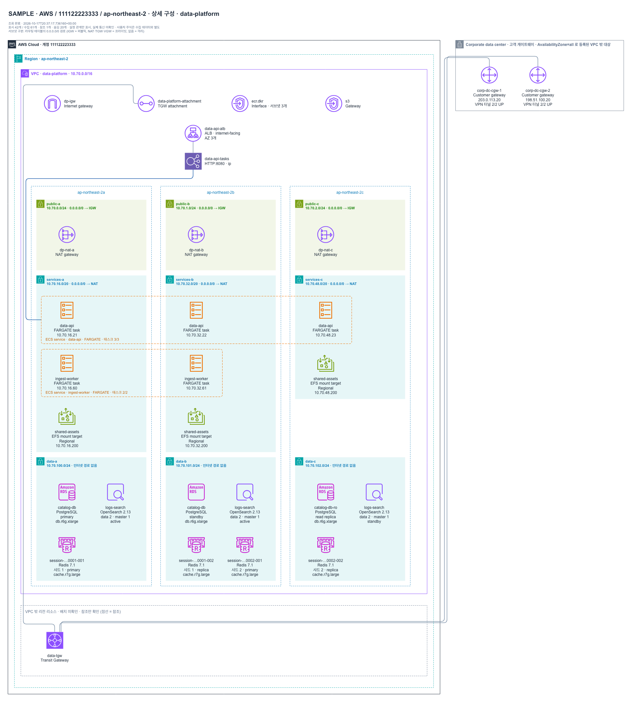
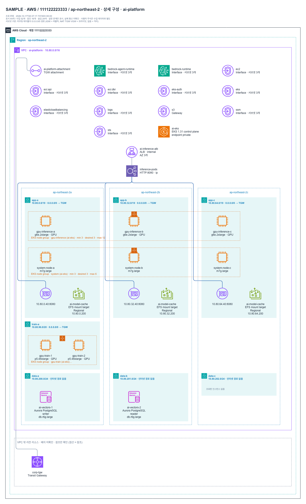

# AWS best practice 인프라 아키텍처 샘플

실제 계정 데이터가 아닌 **합성 샘플**입니다. 수집 범위(VPC·서브넷·EC2·ELBv2·대상 그룹·Internet/NAT Gateway·라우팅 테이블·VPC 엔드포인트·
Transit Gateway·VPC 피어링·Site-to-Site VPN·RDS/Aurora/DocumentDB·ElastiCache·MSK·OpenSearch·EKS·ECS·EFS·Redshift·Lambda·Auto Scaling 그룹)
안에서 표현할 수 있는 AWS 권장 구성 패턴을 골랐습니다. 사례별 근거(Well-Architected·서비스 문서 등 AWS 공식 출처)와 판정은
[docs/ARCHITECTURE.md](../../docs/ARCHITECTURE.md)에 있습니다. 리스너 규칙·Direct Connect·CloudFront·WAF·Route 53처럼 수집 범위 밖인
권고는 그리지 않고 각 사례의 "도형 밖 권고"로 적었습니다.

다이어그램은 AWS Architecture Icons 표기(AWS Cloud > Region > VPC > AZ > public/private 서브넷, 리소스 수준 아이콘)를 따르며
세부 규칙과 의도적 차이는 [배치·표기 규칙](../../docs/engineering/LAYOUT_EVALUATION.md#visual-conventions-aws-architecture-icons)에 있습니다.

- 서브넷 색은 라우팅 테이블의 `0.0.0.0/0` 경로로 정합니다: IGW = 퍼블릭(초록), NAT·TGW·VGW = 프라이빗, 경로 없음 = 격리.
- Auto Scaling 그룹은 AZ를 가로지르는 주황 점선 프레임, ECS 서비스는 태스크를 감싸는 주황 둥근 점선 프레임입니다.
  대상 그룹 → 프레임 연결선 하나가 개별 등록선을 대신합니다(개별 등록은 속성 패널에서 확인).
- 고가용성 역할은 각 리소스 라벨에 표시합니다: RDS primary/standby/read replica, Multi-AZ DB 클러스터 readable standby,
  Aurora·DocumentDB writer/reader, ElastiCache 샤드별 primary/replica, OpenSearch AZ별 data·master 노드 수와 standby AZ,
  MSK AZ별 브로커 ID, Redshift Multi-AZ primary/secondary, EFS Regional/One Zone 마운트 타깃.
- ECS 태스크·EKS 파드처럼 IP로 등록된 대상은 대상 그룹 VPC 안에서 IP가 속한 서브넷 CIDR과 AZ가 하나로 일치할 때만 그 서브넷에 둡니다.
- 가속 인스턴스는 AWS 아이콘이 있는 계열(P3·P4d·P4de·G4dn·G4ad·Trainium·Inferentia·DL1)만 전용 아이콘을 쓰고, 그 밖의 GPU 계열(p5·g6e 등)은
  일반 인스턴스 아이콘에 `GPU` 라벨을 붙입니다. Bedrock·SageMaker 인터페이스 엔드포인트는 서비스 아이콘으로 그립니다.
- Site-to-Site VPN은 VGW/TGW에서 AWS Cloud 오른쪽의 Corporate data center 상자 안 고객 게이트웨이로 이어지며 터널 상태(UP 수)를 표시합니다.

앱에서는 `diagram-bot serve` 후 수집 이력에서 `샘플 · …`을 고르고, CLI에서는 `diagram-bot demo --sample <이름> --output 경로`로 같은 산출물을 만듭니다.
각 폴더에는 다중 페이지 `topology.drawio`(전체 구성 + VPC별 상세), 렌더링한 PNG, `snapshot.json`·`inventory.csv`·`review.md`·`index.html`이 있습니다.

## 3계층 웹 애플리케이션 (3 AZ) — `three-tier`

VPC 1 · 서브넷 12 · EC2 6 · 로드밸런서 2 · 대상 그룹 2 · NAT 3 · RDS/Aurora/DocumentDB 2 · Auto Scaling 그룹 2 · VPC 엔드포인트 4

- 세 AZ에 같은 구성을 배치해 AZ 장애를 견딤 (Reliability)
- 인터넷용 ALB만 퍼블릭 서브넷, 웹·앱·데이터는 프라이빗 서브넷 (Security)
- 웹 계층과 앱 계층 사이에 내부 ALB를 두어 계층별 확장·격리
- AZ마다 NAT 게이트웨이를 두어 프라이빗 서브넷의 외부 통신이 AZ 장애에 묶이지 않음
- 웹·앱 계층은 Auto Scaling 그룹(ELB 헬스 체크)으로 AZ에 분산
- 데이터 계층은 인터넷 경로 없는 격리 서브넷의 RDS Multi-AZ (암호화, 비공개), 읽기는 세 번째 AZ의 읽기 전용 복제본
- S3는 게이트웨이 엔드포인트로 NAT를 거치지 않고, 관리 접근은 SSM·SSM Messages·EC2 Messages 엔드포인트의 Session Manager(배스천 없음)
- 도형 밖 권고: CloudFront(정적 콘텐츠는 S3)·AWS WAF·Route 53 헬스 체크를 진입점 앞에 (REL02-BP01, 수집 범위 밖)

## 마이크로서비스 경로 기반 라우팅 (ALB 1 · 대상 그룹 4) — `microservices`

VPC 1 · 서브넷 6 · EC2 4 · 로드밸런서 1 · 대상 그룹 4 · NAT 2 · RDS/Aurora/DocumentDB 1 · ECS 서비스 2 · ECS 태스크 4 · Auto Scaling 그룹 2 · VPC 엔드포인트 4

- ALB 하나에서 경로별로 서비스 대상 그룹을 나눔 (리스너 규칙은 수집 범위 밖)
- ECS Fargate 서비스(awsvpc)는 태스크 IP를 대상으로 등록, 배포 회로 차단기로 자동 롤백
- 서비스마다 전용 포트·헬스 체크 경로
- 두 AZ 이상에 각 서비스 대상을 분산하고 서비스별 Auto Scaling 그룹
- 서비스 공용 데이터는 격리 서브넷의 RDS Multi-AZ
- 이미지 풀은 ECR API·Docker 인터페이스와 S3 게이트웨이 엔드포인트, 컨테이너 로그는 CloudWatch Logs 엔드포인트로 사설 경로 사용
- 도형 밖 권고: 인터넷용 ALB 앞에 AWS WAF·CloudFront (REL02-BP01, 수집 범위 밖)

## 고정 IP가 필요한 진입점 (NLB → ALB) — `nlb-alb`

VPC 1 · 서브넷 4 · EC2 4 · 로드밸런서 2 · 대상 그룹 3 · NAT 2 · Auto Scaling 그룹 2 · VPC 엔드포인트 1

- 고정 IP·PrivateLink가 필요한 진입점은 NLB, L7 라우팅은 뒤의 ALB (alb 대상 유형)
- TCP 서비스는 NLB 대상 그룹으로 직접 연결
- 두 AZ에 대상을 분산하고 교차 영역 구성
- 관리 접근은 배스천 대신 Session Manager 사용 (인스턴스 퍼블릭 IP 없음)
- 도형 밖 권고: NLB 고정 IP는 AZ마다 Elastic IP, ALB에는 AWS WAF, 대안으로 Global Accelerator (수집 범위 밖)

## 환경별 VPC 분리 (운영 · 스테이징 · 공용 서비스) — `environments`

VPC 3 · 서브넷 12 · EC2 7 · 로드밸런서 2 · 대상 그룹 2 · NAT 4 · Auto Scaling 그룹 2 · TGW 연결 3

- 환경마다 VPC와 CIDR을 분리하고 겹치지 않게 할당 (권장: 계정까지 분리)
- 운영은 3 AZ·AZ별 NAT, 스테이징은 비용을 고려한 2 AZ·NAT 1개
- 공용 서비스 VPC에는 내부 도구만 두고 인터넷 경로 없음
- VPC 간 연결은 Transit Gateway 허브로 일원화 (VPC 피어링 그물망 대신)
- Environment 태그로 소유·비용 구분
- 스테이징 NAT 1개는 비운영 환경의 비용 절충 (REL10-BP01은 운영 워크로드 기준)
- 도형 밖 권고: 환경별 AWS 계정 분리, Network 계정의 TGW를 RAM으로 공유, 운영·스테이징 TGW 라우팅 테이블 분리 (수집 범위 밖)

## 하이브리드 대상 (온프레미스 IP 포함) — `hybrid`

VPC 1 · 서브넷 2 · EC2 2 · 로드밸런서 1 · 대상 그룹 2 · Auto Scaling 그룹 1 · TGW 연결 1 · 고객 게이트웨이 2

- 점진 이전 중 온프레미스 서버를 IP 대상으로 함께 등록 (AvailabilityZone=all)
- VPC 밖 대상은 서브넷에 넣지 않고 별도 영역에 표시
- 클라우드 대상과 온프레미스 대상을 같은 대상 그룹에서 헬스 체크
- 내부 ALB로 사내망 전용 노출
- 온프레미스 대역(192.168.0.0/16)은 Transit Gateway의 Site-to-Site VPN 2개로 연결: 고객 게이트웨이(장비·ISP) 2개, 각각 터널 2개, BGP (REL02-BP02)
- 도형 밖 권고: 운영 주 연결은 Direct Connect(다중 위치), VPN은 백업. 하이브리드 DNS는 Route 53 Resolver 엔드포인트 (수집 범위 밖)

## EKS 플랫폼 (EKS · MSK · ElastiCache · Aurora · Lambda) — `eks-platform`

VPC 1 · 서브넷 9 · EC2 6 · 로드밸런서 1 · 대상 그룹 1 · NAT 3 · RDS/Aurora/DocumentDB 2 · ElastiCache 2 · MSK 브로커 그룹 3 · EKS 1 · Lambda 1 · Auto Scaling 그룹 2 · VPC 엔드포인트 4

- EKS 컨트롤 플레인 엔드포인트는 비공개, 관리형 노드 그룹은 세 AZ 프라이빗 서브넷에 분산
- 인그레스는 AWS Load Balancer Controller의 ALB → IP 대상(파드)
- Aurora PostgreSQL writer/reader를 서로 다른 AZ에, ElastiCache Redis는 primary/replica 자동 장애 조치
- MSK 브로커는 AZ마다 하나, 클라이언트-브로커 TLS
- 데이터 계층(Aurora·Redis·MSK)은 인터넷 경로 없는 격리 서브넷
- ECR API·Docker·STS 인터페이스와 S3 게이트웨이 엔드포인트로 이미지·자격 증명·객체 접근을 사설 경로로
- 도형 밖 권고: 인터넷 ALB에 AWS WAF, MSK 토픽 복제 계수 3 (수집 범위 밖)

## 데이터 플랫폼 (ECS · OpenSearch · RDS · ElastiCache · EFS · Redshift · DocumentDB) — `data-platform`

VPC 2 · 서브넷 12 · 로드밸런서 1 · 대상 그룹 1 · NAT 3 · RDS/Aurora/DocumentDB 4 · ElastiCache 4 · OpenSearch 노드 그룹 3 · ECS 서비스 2 · ECS 태스크 5 · EFS 마운트 타깃 3 · Redshift 2 · VPC 엔드포인트 2 · TGW 연결 2 · 고객 게이트웨이 2

- ECS Fargate 서비스는 세 AZ 프라이빗 서브넷에 태스크를 분산하고 ALB가 태스크 IP를 대상으로 등록
- OpenSearch는 3 AZ · 전용 마스터 노드 · Multi-AZ with Standby (한 AZ의 데이터 노드는 대기)
- RDS PostgreSQL Multi-AZ(동기식 대기) + 세 번째 AZ의 읽기 전용 복제본
- ElastiCache Redis 클러스터 모드: 샤드마다 primary와 replica를 서로 다른 AZ에, 자동 장애 조치
- EFS(리전 클래스)는 AZ마다 마운트 타깃을 두어 AZ 장애에도 같은 AZ 경로로 접근
- 분석 VPC는 Redshift Multi-AZ(서브넷 3개, AZ당 2노드)와 DocumentDB writer/reader
- 두 VPC와 사내 데이터 센터를 Transit Gateway 하나로 연결 (피어링은 비전이적이라 다른 VPC의 VPN을 쓸 수 없음)
- 사내 데이터 센터는 고객 게이트웨이 2개(장비·ISP 분리)의 Site-to-Site VPN, 각각 터널 2개 (REL02-BP02)

## AI 플랫폼 (사설 EKS GPU 추론·학습 · Bedrock · Aurora pgvector) — `ai-platform`

VPC 1 · 서브넷 7 · EC2 8 · 로드밸런서 1 · 대상 그룹 1 · RDS/Aurora/DocumentDB 2 · EKS 1 · EFS 마운트 타깃 3 · Auto Scaling 그룹 3 · VPC 엔드포인트 12 · TGW 연결 1

- 인터넷 경로 없는 사설 VPC: IGW·NAT 없이 Transit Gateway로 사내망·중앙 egress에 연결 (MLSEC03-BP02)
- Bedrock·ECR·EKS·STS·CloudWatch Logs 등은 세 AZ의 인터페이스 엔드포인트, S3는 게이트웨이 엔드포인트로 사설 호출 (GENSEC01-BP02)
- GPU 추론 노드 그룹(g6e)은 세 AZ에 분산하고 내부 ALB가 추론 파드 IP를 대상으로 등록, 자동 확장 (GENREL02-BP01, MLREL05-BP01)
- EFA 학습 노드 그룹(p5)은 의도적으로 한 AZ의 전용 /20 서브넷에, 자기 참조 전체 허용 보안 그룹 (EFA는 AZ를 넘지 못함, HPCREL01-BP02)
- 학습과 추론은 노드 그룹·인스턴스 유형을 분리 (MLPERF04-BP01), 학습 노드 그룹은 0까지 축소 (GENSUS01-BP01)
- RAG 벡터 저장소는 VPC 안 격리 서브넷의 Aurora PostgreSQL(pgvector) writer/reader, 노드 보안 그룹만 허용 (GENSEC01-BP03)
- 모델 캐시는 세 AZ 마운트 타깃의 EFS (EKS AI/ML Storage)
- 도형 밖 권고: 학습 배치는 클러스터 배치 그룹 또는 Capacity Block(둘 중 하나), 체크포인트는 같은 AZ의 S3 연동 FSx for Lustre (GENREL06-BP01)
- 도형 밖 권고: Bedrock 모델 호출 로깅(기본 꺼짐)·Guardrails·InvokeModel만 허용하는 엔드포인트 정책, S3는 SSE-KMS와 aws:SourceVpce (수집 범위 밖)
- 도형 밖 권고: Karpenter·KEDA·NVIDIA/EFA device plugin은 Kubernetes 객체라 그리지 않음 (Karpenter 노드는 ASG 없는 EC2로 표시)

