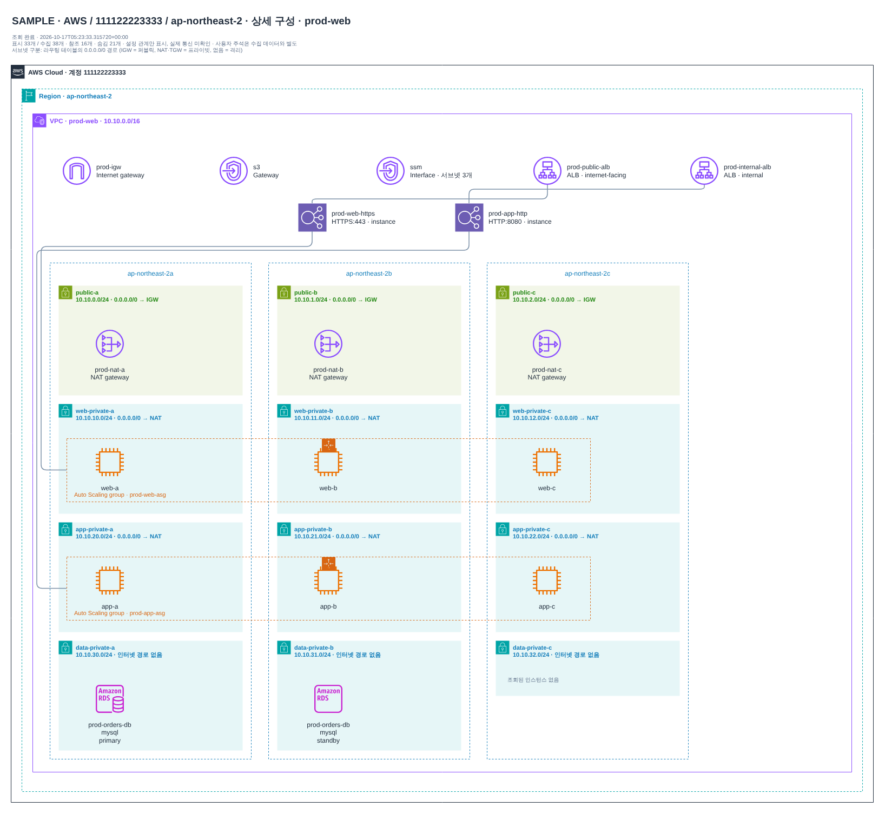
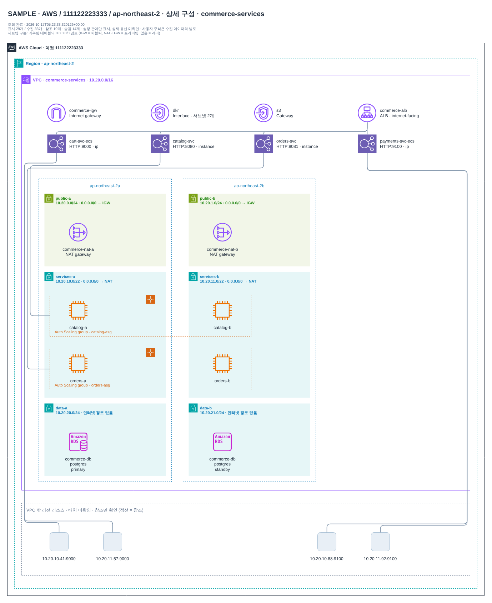
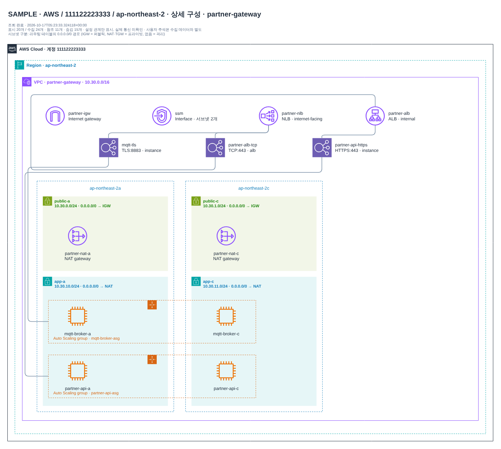
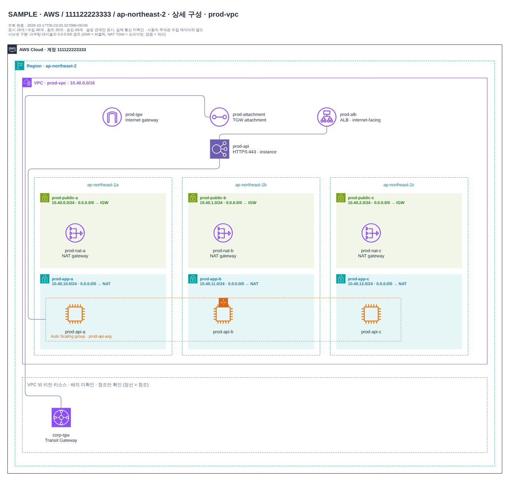
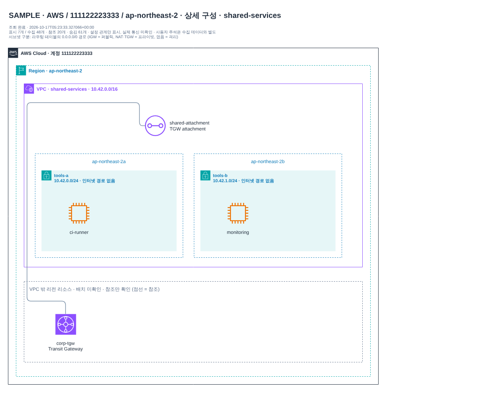
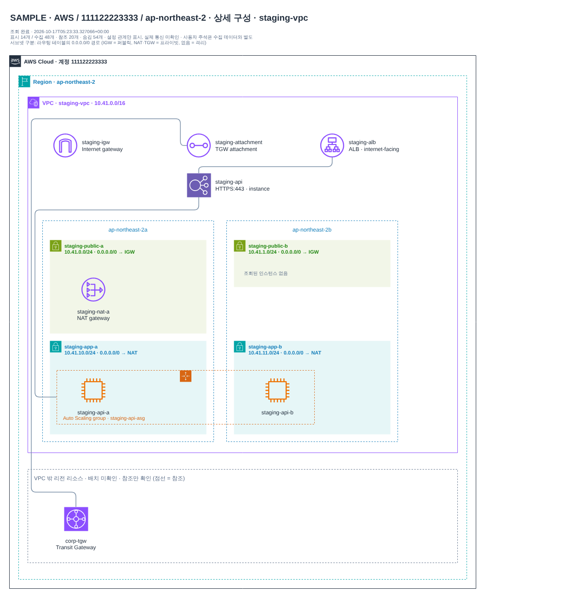
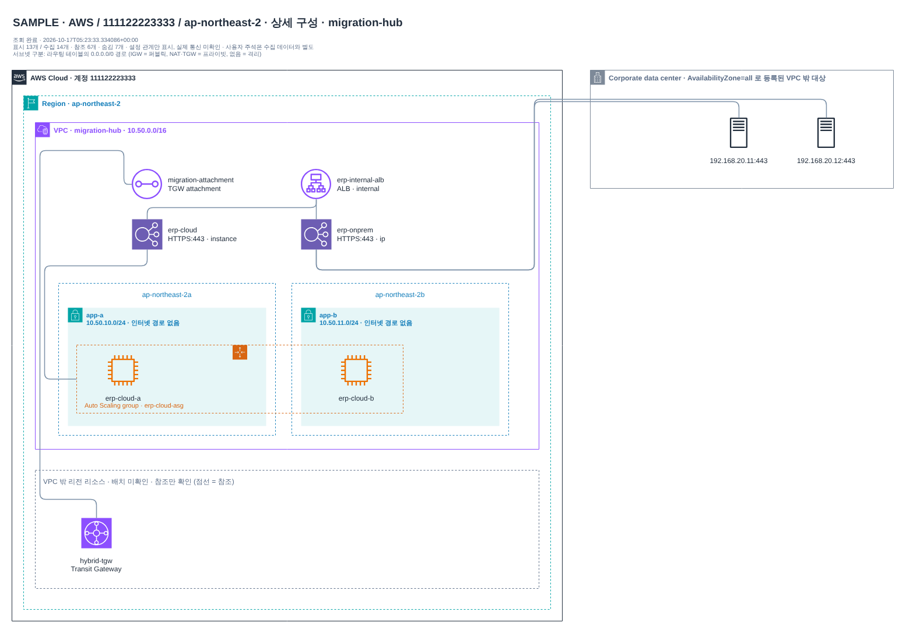

# AWS best practice 인프라 아키텍처 샘플

실제 계정 데이터가 아닌 **합성 샘플**입니다. 수집 범위(VPC·서브넷·EC2·ELBv2·대상 그룹·Internet/NAT Gateway·라우팅 테이블·VPC 엔드포인트·Transit Gateway·RDS·Auto Scaling 그룹) 안에서
표현할 수 있는 AWS 권장 구성 패턴을 골랐습니다. 보안 그룹 규칙·리스너 규칙·VPN/Direct Connect는 수집 범위 밖이라 그리지 않습니다.

다이어그램은 AWS Architecture Icons 표기(AWS Cloud > Region > VPC > AZ > public/private 서브넷, 리소스 수준 아이콘)를 따르며
세부 규칙과 의도적 차이는 [배치·표기 규칙](../../docs/engineering/LAYOUT_EVALUATION.md#visual-conventions-aws-architecture-icons)에 있습니다.

- 서브넷 색은 라우팅 테이블의 `0.0.0.0/0` 경로로 정합니다: IGW = 퍼블릭(초록), NAT = 프라이빗, 경로 없음 = 격리.
- Auto Scaling 그룹은 AZ를 가로지르는 주황 점선 프레임이며, 대상 그룹 → ASG 연결선 하나가 개별 인스턴스 등록선을 대신합니다(개별 등록은 속성 패널에서 확인).
- RDS Multi-AZ는 서브넷 그룹과 AZ가 일치하는 서브넷에 기본·대기 인스턴스로 표시합니다.

앱에서는 `diagram-bot serve` 후 수집 이력에서 `샘플 · …`을 고르고, CLI에서는 `diagram-bot demo --sample <이름> --output 경로`로 같은 산출물을 만듭니다.
각 폴더에는 다중 페이지 `topology.drawio`(전체 구성 + VPC별 상세), 렌더링한 PNG, `snapshot.json`·`inventory.csv`·`review.md`·`index.html`이 있습니다.

## 3계층 웹 애플리케이션 (3 AZ) — `three-tier`

VPC 1 · 서브넷 12 · EC2 6 · 로드밸런서 2 · 대상 그룹 2 · NAT 3 · RDS 1 · Auto Scaling 그룹 2 · VPC 엔드포인트 2 · TGW 연결 0

- 세 AZ에 같은 구성을 배치해 AZ 장애를 견딤 (Reliability)
- 인터넷용 ALB만 퍼블릭 서브넷, 웹·앱·데이터는 프라이빗 서브넷 (Security)
- 웹 계층과 앱 계층 사이에 내부 ALB를 두어 계층별 확장·격리
- AZ마다 NAT 게이트웨이를 두어 프라이빗 서브넷의 외부 통신이 AZ 장애에 묶이지 않음
- 웹·앱 계층은 Auto Scaling 그룹(ELB 헬스 체크)으로 AZ에 분산
- 데이터 계층은 인터넷 경로 없는 격리 서브넷의 RDS Multi-AZ (암호화, 비공개)
- S3는 게이트웨이 엔드포인트로 NAT를 거치지 않고, 관리 접근은 SSM 인터페이스 엔드포인트(배스천 없음)

## 마이크로서비스 경로 기반 라우팅 (ALB 1 · 대상 그룹 4) — `microservices`

VPC 1 · 서브넷 6 · EC2 4 · 로드밸런서 1 · 대상 그룹 4 · NAT 2 · RDS 1 · Auto Scaling 그룹 2 · VPC 엔드포인트 2 · TGW 연결 0

- ALB 하나에서 경로별로 서비스 대상 그룹을 나눔 (리스너 규칙은 수집 범위 밖)
- 컨테이너(awsvpc) 서비스는 IP 대상 유형으로 등록
- 서비스마다 전용 포트·헬스 체크 경로
- 두 AZ 이상에 각 서비스 대상을 분산하고 서비스별 Auto Scaling 그룹
- 서비스 공용 데이터는 격리 서브넷의 RDS Multi-AZ
- 이미지 풀·S3 접근은 ECR 인터페이스·S3 게이트웨이 엔드포인트로 사설 경로 사용

## 고정 IP가 필요한 진입점 (NLB → ALB) — `nlb-alb`

VPC 1 · 서브넷 4 · EC2 4 · 로드밸런서 2 · 대상 그룹 3 · NAT 2 · RDS 0 · Auto Scaling 그룹 2 · VPC 엔드포인트 1 · TGW 연결 0

- 고정 IP·PrivateLink가 필요한 진입점은 NLB, L7 라우팅은 뒤의 ALB (alb 대상 유형)
- TCP 서비스는 NLB 대상 그룹으로 직접 연결
- 두 AZ에 대상을 분산하고 교차 영역 구성
- 관리 접근은 배스천 대신 Session Manager 사용 (인스턴스 퍼블릭 IP 없음)

## 환경별 VPC 분리 (운영 · 스테이징 · 공용 서비스) — `environments`

VPC 3 · 서브넷 12 · EC2 7 · 로드밸런서 2 · 대상 그룹 2 · NAT 4 · RDS 0 · Auto Scaling 그룹 2 · VPC 엔드포인트 0 · TGW 연결 3

- 환경마다 VPC와 CIDR을 분리하고 겹치지 않게 할당 (권장: 계정까지 분리)
- 운영은 3 AZ·AZ별 NAT, 스테이징은 비용을 고려한 2 AZ·NAT 1개
- 공용 서비스 VPC에는 내부 도구만 두고 인터넷 경로 없음
- VPC 간 연결은 Transit Gateway 허브로 일원화 (VPC 피어링 그물망 대신)
- Environment 태그로 소유·비용 구분

## 하이브리드 대상 (온프레미스 IP 포함) — `hybrid`

VPC 1 · 서브넷 2 · EC2 2 · 로드밸런서 1 · 대상 그룹 2 · NAT 0 · RDS 0 · Auto Scaling 그룹 1 · VPC 엔드포인트 0 · TGW 연결 1

- 점진 이전 중 온프레미스 서버를 IP 대상으로 함께 등록 (AvailabilityZone=all)
- VPC 밖 대상은 서브넷에 넣지 않고 별도 영역에 표시
- 클라우드 대상과 온프레미스 대상을 같은 대상 그룹에서 헬스 체크
- 내부 ALB로 사내망 전용 노출
- 온프레미스 대역(192.168.0.0/16)은 Transit Gateway로 라우팅 (VPN/Direct Connect 연결은 수집 범위 밖)

